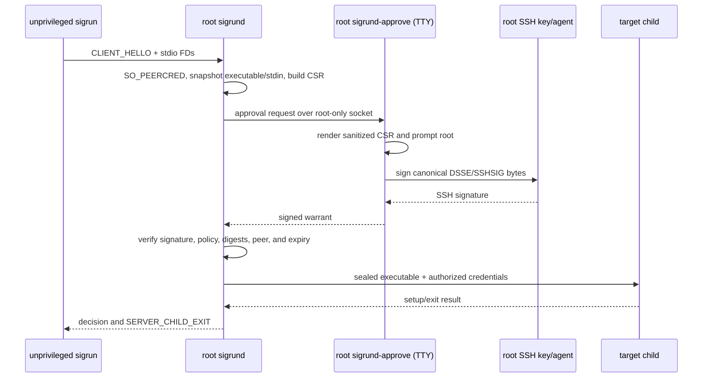

# sigrun/sigrund executable MVP roadmap

This roadmap turns the security specification into the first end-to-end
workflow that can be demonstrated on one Linux host:

1. An unprivileged user invokes `sigrun` with a command and standard I/O.
2. Root runs a foreground `sigrund-approve` process attached to a TTY.
3. `sigrund` presents the request to that root process.
4. Root confirms the displayed request and signs the exact canonical warrant
   with a root-controlled SSH key or SSH agent.
5. `sigrund` verifies the signed warrant, executes the sealed command for the
   authorized target identity, and returns the child's exit status to
   `sigrun`.

The first vertical slice uses `stdio`, local audit, one signed request at a
time, and `require_remote_audit_ack = false`. It excludes PTY transfer,
hooks, OpenPGP, Sigstore, remote collector ACKs, reload, and the full quota
stress matrix until the slice is working. Excluding those features is an MVP
scope decision. Section 6.3 of the specification defines the optional local
approval profile; the remaining v1.0 features retain their existing requirements.

## Current status

Phases 0–3 provide the contracts, foreground socket service, requester relays,
sealed snapshots and root TTY approval with OpenSSH signing. The daemon verifies
the returned signature and exact CSR, then returns an explicit rejection while
durable authorization and command execution await Phases 4–5. Phase 3 evidence
and reproducible gates are in [docs/MVP_PHASE3.md](docs/MVP_PHASE3.md).

- [x] Protocol, policy, snapshot, lifecycle, state, audit, memfd, and cgroup
  primitives with unit tests.
- [x] Raw `ssh-ed25519` and `sk-ssh-ed25519` SSHSIG verification helpers.
- [x] Phase 0: thin-MVP types and profile.
- [x] Phase 1: daemon and approval-broker sockets.
- [x] Phase 1.5: cleanup isolation, retained request ownership, root pinning,
  streaming snapshot foundations and updated request-profile gates.
- [x] Phase 2: client transport and common snapshots.
- [x] Phase 3: root TTY approval and SSH signing.
- [x] Phase 4: authorization, commit, and local audit integration (local-only
  boundary; Phase 5 execution remains pending).
- [ ] Phase 5: child execution and exit relay.
- [ ] Phase 6: two-UID end-to-end fixture.

### Midpoint review and follow-through

Phases 0 and 1 delivered their documented contract and transport gates. Review
found and fixed SSH feature/encoding errors, recovery/provisioning defects,
blocking FD metadata checks, and connection-specific credential errors. That
evidence supports the completed phases, but does not establish snapshot,
authorization, or execution conformance. Their fixtures use namespace-root;
they do not verify the host-root cgroup/credential execution path.

The following corrections are required work in the remaining phases. They are
planned contracts, not claims about currently available CLI options or behavior.

| Finding or ambiguity | Delivery phase | Acceptance evidence |
| --- | --- | --- |
| Direct TTY stdout/stderr violate the default `stdio/null` FD matrix | 2 | Pipe relay works from a real requester terminal, under backpressure and with large output (M-11). |
| Target identity, capabilities, environment, stdin, status and signing-key selection lack a complete CLI contract | 2–3 | Documented defaults/options round-trip into the displayed and signed CSR; no hidden inherited values (M-12). |
| Broker wait, busy/no-approver behavior, stale replies and prompt cancellation are unspecified | 3 | One bounded outstanding request; monotonic timeout and reconnection races (M-13). |
| Approval display can omit security-relevant fields or confuse arguments | 3 | Complete escaped field display, indexed argv, explicit default-deny confirmation (M-12). |
| Metadata workers alone do not cover every blocking filesystem operation | 1.5, 2, 4–5 | Phase 1.5 gates received-FD disposal and snapshot ownership; later phases integrate source opens, audit and job cleanup (M-14). |
| A multithreaded daemon cannot safely run ordinary Rust setup after clone | 5 | Audited syscall-only child path and deterministic setup/reaper race tests (M-08, M-15). |
| Retaining the initial audit key defeats forward secrecy after host compromise | 4 | Documentation and diagnostics describe local integrity limits accurately; external checkpoint work remains explicit. |
| Cgroup startup and narrow capability semantics are unproven at runtime | 5–6 | Real delegated-cgroup probes and post-exec credentials for root and a service UID (M-15). |
| Helper coverage can be mistaken for release coverage | Every phase | Per-phase evidence and M/V traceability; full v1.0 conformance requires the complete V matrix. |

Do not reopen completed phases merely to relabel them. Extend their contracts
and tests in the owning phase above, documenting any change from the frozen
Phase 0 interface. Preserve the Phase 1 regression fixtures as required gates.

## The target interaction

The daemon never reads the root user's private key or TTY. The approval process
is a separate root-owned foreground client. It receives a request over a
root-only broker socket, renders the canonical request, asks for confirmation,
and returns a signature over the exact bytes it approved.



## MVP contract

The MVP is complete only when all of these statements hold:

- The daemon starts only after configuration, signer policy, host identity,
  audit state, and required local paths pass fail-closed validation.
- The client and daemon communicate using the Section 2 binary framing and
  the Section 2.3 descriptor ownership rules. The daemon obtains the caller's
  UID/GID from `SO_PEERCRED`; request JSON cannot claim identity.
- The daemon snapshots the executable before approval, hashes the sealed
  bytes, and sends the root approver the digest and every field that will be
  signed. The approved warrant must match the retained snapshot and CSR
  byte-for-byte at authorization time.
- The approval socket is a root-owned `SOCK_STREAM` endpoint with mode `0600`
  and peer-credential gates in both directions. Only UID 0 may approve or sign.
- The prompt displays the executable path, argv, cwd, requester UID/GID,
  target UID/GID and supplementary groups, capabilities, exact environment,
  umask, script permission, tty/stdin mode and digests, grant/host/execution IDs,
  validity window, and signer identity/key fingerprint. Values are sanitized
  according to Section 3.3; argv entries are indexed and quoted independently.
- A refusal, timeout, disconnect, signature failure, policy mismatch, or
  snapshot mutation produces no child and no successful authorization.
- The private key remains in the root process or its SSH agent. `sigrund`
  receives only the SSHSIG signature and verifies it against the configured
  public key and `sigrun.warrant.v1` namespace.
- A successful child produces `READY_TO_EXEC`, then exactly one
  `SERVER_CHILD_EXIT`. `sigrun` returns the child's exit code or `128 + signal`.
- Every accepted authorization and child outcome is written to the local
  hash-chained audit log. A remote collector is not part of this first slice.

### Requester and operator experience

Phase 2 extends the frozen client parser with these explicit defaults and
options. Unsupported values fail before sending a hello; the daemon independently
enforces the profile for hand-crafted requests.

| Input | Thin-MVP behavior |
| --- | --- |
| `-- /absolute/program ARG...` | Required absolute executable, exact argv including empty arguments; no shell evaluation, PATH search or silent symlink resolution. |
| `--target-uid UID`, `--target-gid GID` | Defaults `0:0`; numeric identities checked against signer policy. |
| `--supplementary-gid GID`, `--capability CAP` | Repeatable, default empty; reject duplicates and serialize canonical order. Root UID with an empty capability set does not imply all root capabilities. |
| `--cwd PATH` | Default captured absolute cwd, explicit override supported; its path is signed, its directory contents and dependencies are not sealed. |
| `--env NAME=VALUE`, `--umask OCTAL` | Default exact environment `LANG=C.UTF-8`, `PATH=/usr/sbin:/usr/bin`; default umask `077`. Explicit entries replace those defaults by name; reject duplicate explicit names. No inherited environment or caller allowlist in this profile. |
| `--stdin null\|sha256` | Default `null`; `sha256` consumes bounded file/pipe input through EOF within the snapshot deadline. Reject TTY stdin for `sha256`. Unrestricted input, PTY and scripts are deferred. |
| `--ttl-secs SECONDS` | Default 900, positive, subject to captured daemon/signer ceilings. Only `one_time` grants; waiting for approval does not refresh the signed expiry. |
| `--status-fd N`, `--auth-fail-exit-code CODE` | Implement Section 2.1 status JSON and exit semantics; default denial exit 255, protocol/disconnect failure 254, ordinary usage error 64. Keep status output separate from child output. |

For the unsigned human-approval path, the daemon uses a root-configured
`mvp.approval_signer_id` selecting exactly one SSH signer. Phase 3 implements
and tests that setting. An empty value preserves CSR-only behavior; execution
requires an explicit signer. The approver accepts `--signers PATH` and `--identity PATH`:
the former loads the same root-owned public signer policy, and the latter
selects a private key or public key backed by root's SSH agent. There is no
first-key-in-agent fallback. The selected key must match the requested signer.

Use OpenSSH `ssh-keygen -Y sign -n sigrun.warrant.v1 -O hashalg=sha512 -f PATH`
as the first signing backend, launched directly with fixed arguments and PAE
bytes on stdin. OpenSSH can use an agent-held key via its public-key file;
an encrypted private key may prompt on root's controlling TTY. Bound output,
watch broker cancellation concurrently, terminate/reap the helper on abort,
and verify the resulting SSHSIG locally before returning it. A native agent
adapter is optional follow-on work, with the same interoperability gate.

The default requester terminal must work without weakening Section 2.3:
create separate stdout/stderr pipes, pass their write ends, and relay the read
ends locally. Never pass the requester's TTY to the daemon in `null` or
`sha256` mode. Keep output queues bounded, close unused pipe ends, and service
control/signal events even when a local sink blocks. After child exit, drain
both pipes through EOF before normal client exit; never merge streams or
discard buffered output. A broken local sink aborts the request. Before
readiness, Ctrl-C cancels by closing the control socket; after readiness,
forward only the specification's signal allowlist. No raw-terminal mode is
needed for this slice. Arbitrary child output is not trusted prompt text and
must never appear on the separate approver TTY.

Broker behavior follows Section 6.3: no approver means immediate
`TIMEOUT_CSR`; busy means `RESOURCE_EXHAUSTED`; explicit refusal means
`REJECTED`; a 120-second cumulative approval timeout or broker loss means
`TIMEOUT_CSR`. These outcomes neither consume the grant nor spawn. Root sees
`Approve and sign? [y/N]`; only explicit `y`/`yes` approves. The daemon closes
the broker connection to invalidate a cancelled outstanding prompt. Reconnect
permits a fresh request, never resurrection of an old execution ID. The
requester sees a local waiting diagnostic on stderr, without inventing a new
wire decision or implying authorization succeeded.

### Code ownership and implementation structure

- Keep `sigrund-core` responsible for pure parsing, canonical bytes, policy,
  crypto and lifecycle contracts. Keep Linux transport, workers, coordinator,
  broker, audit executor, job setup and reaping in focused runtime modules;
  binary entry points only parse options and report results.
- One coordinator owns request transitions and the single decision slot.
  Workers return typed owned results tagged with execution ID and phase/token;
  no worker commits, publishes readiness, or spawns on its own authority.
- Move `OwnedFd`, sealed snapshots and quota reservations together through
  explicit ownership types. Avoid naked descriptor integers outside narrow
  syscall interfaces. Cleanup that can block must execute off-loop, including
  descriptor rejection and late-result disposal; retain its reservation.
- Use bounded queues and the shared worker budget for metadata plus snapshots.
  Do not multiply the 16/2 ceilings with independent pools. Serialize durable
  database/audit operations off-loop and define poison/failure propagation.
- Prepare argv/envp, descriptor actions and bounded mount-verification buffers
  in the parent. The post-clone child uses an audited syscall-only path through
  exec or `_exit`; no allocator, formatting, locks, panics or Rust destructors.
- Treat cancellation, stale completions and backpressure as normal typed
  outcomes. Do not grow `daemon::run` into the implementation of every phase.

### Supported stories and limits

| Story | MVP gate or later milestone |
| --- | --- |
| User requests `/usr/bin/id -u` from a terminal; root confirms using an SSH key | M-01, M-11, M-12: terminal output and exact exit status, UID 0 with explicitly bounded capabilities. |
| A command runs as a dedicated service UID with selected groups/capabilities | M-15: post-exec identity and capability probe; same-UID elevation stays disabled in this profile. |
| A batch command consumes a finite reviewed input document | M-11: sealed `sha256` stdin, prompt displays digest and binding, output redirection works. |
| Automation submits an already signed warrant | Phase 4 adds `sigrun --warrant PATH` (mutually exclusive with unsigned construction); same snapshot, policy and profile gates, no broker required. M-06 proves one-time replay behavior. |
| Root refuses, is absent, loses its terminal, or selects the wrong key | M-02, M-12, M-13: bounded failure, actionable diagnostic, no execution. |
| Requester interrupts, output blocks, or daemon restarts | M-07, M-10, M-11, M-14: cancellation/recovery and bounded resources; no automatic replay after uncertain commit. |
| Interactive shell/editor, scripts, reusable warrants, remote approval/audit, reload, OpenPGP/Sigstore | Separate post-MVP milestones; unsupported requests fail explicitly. |

Approving a root command delegates the effects of its argv, input, environment,
working directory and mutable dependencies. The executable digest alone does
not make arbitrary interpreters or root workloads safe. UID 0 execution has
Section 1.1's best-effort containment. Local audit retains `K_0` and provides
integrity checks under protected-state assumptions, not forward secrecy after
root compromise or protection against whole-state rollback.

## Work plan

Each phase has a concrete exit gate. Do not begin the next phase while its
gate is failing. For an M case spanning several phases, gate each phase's
portion with its focused fixture; the complete real-binary case gates Phase 6.

| Phase | Main result | Estimate |
| --- | --- | ---: |
| 0 | Frozen MVP schemas and profile | 1 day |
| 1 | Daemon and root-only broker sockets | 1–2 days |
| 1.5 | Midpoint code-review leftovers and foundation regressions | Additional gate before Phase 2 |
| 2 | Client transport and sealed snapshots | 2–3 days |
| 3 | Root TTY approval and SSH signing | 2–3 days |
| 4 | Authorization, one-time commit, and local audit | 2–3 days |
| 5 | `clone3`, credentials, reaping, and exit relay | 3–5 days |
| 6 | Two-UID integration fixture and hardening | 2–3 days |
| **Total** | **Thin end-to-end MVP** | **13–20 person-days** |

The estimate assumes the existing primitives remain usable and a Linux
engineer familiar with Rust, Unix sockets, namespaces, cgroups, and SSHSIG.
The estimates are original planning ranges, not a measured completion date.
Phases 2–6 total 11–17 person-days before contingency for the additional gates
above. Re-estimate after the client and real OpenSSH signing slice works.
PTY, hooks, remote collectors, and the complete V-01–V-19 matrix are a
follow-on effort; security cases applicable to the thin path run before MVP
completion, even when their V row also covers deferred features.

### Phase 0: freeze the thin-MVP boundary

Completed. The frozen configuration, command forms, broker documents, binding
rules, and verification commands are in [docs/MVP_PHASE0.md](docs/MVP_PHASE0.md).
This phase defines and tests the contracts; socket transport, approval prompts,
and execution are delivered by the subsequent phases.

Deliverables:

- Add a short MVP profile to the daemon configuration: `stdio` only, no hooks,
  no PTY, no remote ACK, and a single active approval request.
- Define the command forms and socket overrides used by tests, for example:
  `sigrund --foreground`, `sigrund-approve --socket PATH --tty /dev/tty`, and
  `sigrun --socket PATH -- COMMAND ARG...`.
- Add the missing warrant, CSR, DSSE envelope, and approval-message types to
  `sigrund-core` with strict JCS round-trip validation.

Exit gate (implemented local-audit slice):

```sh
cargo test --workspace
cargo clippy --workspace --all-targets -- -D warnings
```

The new types must reject unknown fields, duplicate keys, non-integer numbers,
oversized strings/arrays, and mismatched CSR/warrant fields before any spawn.

### Phase 1: daemon startup and local sockets

Completed. Startup, transport behavior, isolated two-UID verification, and
operator commands are documented in [docs/MVP_PHASE1.md](docs/MVP_PHASE1.md).
The service cannot yet authorize or execute a command.

Deliverables:

- Move the normal `sigrund` path from validation-only mode into a foreground
  daemon loop with an injectable socket path for tests.
- Complete host identity and audit recovery before binding the client socket.
- Bind `/run/sigrund.sock` with the ownership and mode from the specification,
  enable `SO_PEERCRED`, and enforce active socket limits at `accept4()`.
- Add a separate root-only approval broker socket. Reject untrusted broker
  peers before parsing request data.
- Add bounded read/write helpers around `FrameAssembler`, cumulative frame
  deadlines, and descriptor cleanup.

Exit gate:

- A test daemon accepts a client hello, records the peer UID/GID, and rejects
  malformed or oversized frames without leaking descriptors.
- A non-root process cannot connect to the approval broker or submit a signed
  decision through it.

### Phase 1.5: cleanup isolation and snapshot foundations

Completed. Implement–Verify–Fix work and exit evidence are tracked in
[docs/MVP_PHASE1_5.md](docs/MVP_PHASE1_5.md). Resolve all five rows before
starting Phase 2: receive/dispose caller rights on reserved I/O workers,
separate directory pinning from file opens, retain validated request and quota
ownership across continuations, supply bounded streaming/sealed snapshot
builders, and enforce the expanded thin-profile restrictions before metadata.
Run the focused probes, fix failures, then run the full Phase 0/1 regressions
and minimum-toolchain/Clippy/formatting gates. At that phase boundary, client
transport and signing-key selection remained Phases 2–3 work. Those phases
are now complete; durable authorization and execution remain Phases 4–5.

### Phase 2: client hello and common snapshots

Deliverables:

- Implement `sigrun` command parsing, current-working-directory capture,
  exact environment construction, and `stdio` `SCM_RIGHTS` delivery.
- Implement the requester defaults/options and output relay above; add real
  terminal and slow-output fixtures before claiming the primary story works.
- Implement the common executable snapshot worker using anchored roots,
  bounded reads, cancellation checks, memfd seals, ownership, and digest
  binding.
- Implement hashed-stdin snapshots for `stdin_policy = "sha256"`; use
  `/dev/null` for `null`.
- Keep all source FDs, workers, and snapshot quota reservations owned until
  their actual cleanup completes.
- Integrate Phase 1.5's retained worker lease and streaming snapshot builders
  with anchored source opens, CSR construction and coordinator handoff. Reuse
  its directory-pinning/file-open split and disposal regressions; do not create
  a second pool or drop reservations between metadata and snapshots.

Exit gate:

- The daemon can inspect a real request from a non-root test account and
  produce a canonical CSR without invoking a hook or reopening the source
  executable.
- Mutation, traversal, FIFO/socket/directory descriptors, timeout, and
  cancellation tests fail closed.
- M-11's terminal relay and stdin cases and M-14's filesystem stall cases pass.
  A source write need not be detected if size remains unchanged: acceptance
  binds the completed sealed bytes, not an atomic view of the source file.

### Phase 3: root approval and SSH signing

Deliverables:

- Implement `sigrund-approve` as a foreground root process. It receives a
  bounded approval request, displays the sanitized fields, and handles `yes`,
  `no`, EOF, timeout, and disconnect.
- Use the existing `ApprovalRequest.csr_payload` exact canonical bytes. Form
  DSSE PAE over those bytes for SSHSIG signing; signing the CSR or its digest
  directly is incorrect. Reject every returned warrant that changes a CSR field.
- Implement the OpenSSH signing backend, explicit signer/key selection and
  helper cancellation contract above. Decode armored output to the raw
  binary SSHSIG envelope required by Section 3.4.
- Bind the configured signer ID, public key, namespace, signature algorithm,
  and optional FIDO UP/UV flags. Keep private-key bytes out of daemon memory.

Exit gate:

- A real root TTY can approve and sign one request with an `ssh-ed25519` key.
- A changed argv, digest, target UID, or CSR byte causes authorization
  failure, even when the signature itself is valid.
- Root refusal and approval timeout never consume a one-time grant or spawn.
- M-12 and M-13 pass, including OpenSSH software-key interoperability,
  wrong-key/namespace/PAE failures and expired/cancelled prompts. Simulated SK
  verification is not evidence of physical FIDO signing; document that test
  separately before advertising hardware-key operation.

### Phase 4: authorization, commit, and local audit

Deliverables:

- Implement the complete local Section 4.2 authorization predicate for the
  thin profile: host, peer credentials, signer ceilings, path identity,
  command/stdin digests, environment, tty/stdin compatibility, validity, and
  same-UID guard.
- Integrate `StateStore::authorize` with the lifecycle CAS reservations.
- Append `AUTH_COMMIT`, `AUTH_ABORTED_POST_COMMIT`, rejection, and diagnostic
  records through the serialized audit writer.
- Return the specified decision status and sanitized message to the client.
- Add signed-warrant client input and reject every unsupported profile field
  for both signed and unsigned requests. Verify time and revocation again
  after human approval; never modify signed bytes to renew an expired request.
- Keep the SQLite and audit executors bounded and off-loop. On durable-write
  failure follow the poison/reconciliation rules; never send readiness or
  silently retry a possibly consumed grant.

Exit gate:

- Approved requests pass the local authorization gate exactly once; one-time
  redemption is durably consumed and later attempts return `REPLAY_DETECTED`.
- Expired, revoked, wrong-peer, wrong-host, wrong-signer, digest-mismatch,
  and invalid snapshots return the specified denial without a child. Changes
  to the source after sealing do not invalidate or replace the retained bytes.
- Audit reopen and crash-recovery tests pass after approval and denial paths.
- The namespace fixture covers the approved, refused, expired, disconnected,
  and malformed paths, including authenticated `AUTH_COMMIT` and
  `AUTH_ABORTED_POST_COMMIT` records. Core state/audit tests cover M-06, M-10,
  and the guarded cancellation/persistence cases. Concurrent runtime replay
  and remote ACK remain Phase 4 follow-up work.

### Phase 5: child execution and exit relay

Deliverables:

- Complete Section 1.2 startup hierarchy and required kernel-interface probes
  before accepting execution requests; `--check-cgroup` alone is insufficient.
- Create the per-job cgroup and apply memory, swap, OOM, and PID limits.
- Implement `clone3()` with `CLONE_INTO_CGROUP`, `CLONE_PIDFD`, and the
  namespace/credential transition required for the selected MVP target.
- Build the deterministic descriptor table for stdin/stdout/stderr and the
  sync-pipe readiness/error handshake.
- Add the central reaper, disconnect cancellation, cgroup teardown, and
  `SERVER_CHILD_EXIT` serialization.
- Keep the commit and spawn reservation phases intact when cancellation wins.
- Implement the parent-prepared syscall-only child path. Register PID/pidfd
  ownership before dispatching any pending reaper event, preserving an early
  exit until sync-pipe classification and the decision have completed.

Exit gate:

- `sigrun --socket ... -- /usr/bin/id` returns the approved child's exact
  status and leaves no job cgroup, pidfd, or request FD behind.
- Kill-before-ready, exec error, timeout, client disconnect, and child signal
  cases produce the specified result and audit records.
- M-08, M-14 and M-15 pass on a real delegated cgroup v2 hierarchy, including
  missing swap/clone/mount support, actual credential/capability read-back,
  concurrent child exits, and setup failures at each step.

### Phase 6: end-to-end MVP fixture

Add an isolated Linux fixture with:

- a root account running `sigrund` and `sigrund-approve` on a controlled TTY;
- a separate unprivileged requester account;
- a dedicated root SSH signing key or test SSH agent;
- a pinned executable under an allowed root;
- temporary socket, state, log, and cgroup paths; and
- deterministic gates around approval, commit, clone, readiness, and exit.

The fixture must ship an executable harness with prerequisite diagnostics,
temporary provisioning/configuration and cleanup, plus a manual two-terminal
walkthrough. Missing kernel/delegation requirements fail the execution gate;
namespace-only transport tests cannot substitute for it. The following are
target commands after Phases 2–5, not commands that execute successfully today.
Run the root terminals in a provisioned disposable host with a delegated
cgroup (for example a systemd service with `Delegate=yes`):

```sh
# root terminal 1; config includes [mvp] approval_signer_id
sigrund --foreground --config "$TEST_CONFIG" --signers "$TEST_SIGNERS" \
  --state-dir "$TEST_STATE" --log-path "$TEST_LOG" \
  --socket "$TEST_SOCKET" --approval-socket "$TEST_APPROVAL_SOCKET"

# root terminal 2
sigrund-approve --socket "$TEST_APPROVAL_SOCKET" --tty /dev/tty \
  --signers "$TEST_SIGNERS" --identity "$TEST_SSH_IDENTITY"

# separate login as mvp-requester; default stdout/stderr are a real TTY
sigrun --socket "$TEST_SOCKET" -- /usr/bin/id -u
```

The fixture passes only when the root prompt shows the request, the root
signature is accepted, the command runs under the authorized credentials, the
requester receives its output and exit status, and denial/mutation/replay
subcases all fail closed.

## Required tests by milestone

The thin workflow should add these focused integration cases before expanding
scope:

| ID | Case | Required result |
| --- | --- | --- |
| M-01 | Root approval and valid SSH signature | One child runs and its status reaches `sigrun`. |
| M-02 | Root refusal and approval timeout | No spawn, no grant consumption, bounded denial. |
| M-03 | Non-root approval-socket connection | Rejected before request parsing. |
| M-04 | CSR mutation after approval | Signature or field binding fails; no spawn. |
| M-05 | Executable mutation during snapshot | Size/EOF violations deny; same-size writes bind only the resulting sealed bytes. An approval cannot substitute another snapshot. |
| M-06 | Same one-time warrant from concurrent connections with matching UID/GID | Exactly one commit; all others replay-denied. Wrong-UID requests are separately policy-denied. |
| M-07 | Client disconnect during approval/commit/spawn | Reservation reconciliation and cleanup complete. |
| M-08 | Child exits normally, by signal, and before readiness | Exact decision and exit contract. |
| M-09 | Descriptor truncation/extra FD and oversized frame | Connection closes; no leaked FD or child. |
| M-10 | Audit restart after partial and forward-recovery windows | Startup succeeds only for valid recoverable states. |
| M-11 | Requester TTY, file/pipe output, large output, blocked/broken sink, null/hashed stdin | Default terminal invocation works using pipes; bounded queues, exact separate output/status, complete drain and responsive cancellation. |
| M-12 | CLI defaults, complete approval display, real SSH signing | Exact CSR/PAE binding; no hidden environment or ambiguous argv; wrong key, namespace, payload, blank confirmation and non-TTY approver fail closed. |
| M-13 | No approver, busy slot, slow signing, stale/duplicate response, broker loss/reconnect | Section 6.3 outcomes; original deadline preserved; no old execution resurrected; helper and snapshot ownership reconciled. |
| M-14 | Blocked open/fstat/read/close, SQLite/fsync and job cleanup | Other control traffic/deadlines remain responsive; bounded admission; no early quota release, replacement workers or late readiness. |
| M-15 | Root and service-UID execution; unsupported kernel/cgroup features; post-clone setup | Actual namespace, FD, signal, group, capability and cgroup behavior verified; fail closed before readiness on every setup error. |

Record command, platform/kernel, test result and artifact for each M case.
Use this traceability when selecting the applicable V subcases for the thin path:

| MVP coverage | Required specification cases/subcases |
| --- | --- |
| M-01, M-04, M-06, M-12, M-13 | V-01–V-03 authorization, binding, software/SK verification and replay; broker cases additionally follow Section 6.3. |
| M-05, M-09, M-11, M-14 | V-04–V-05 snapshot/environment and applicable V-07, V-13–V-14 stdio, transport and worker checks. |
| M-07, M-08, M-15 | V-06, V-08 job-handshake/reaper subcases, V-10–V-11, V-15 and V-17 child, containment, cancellation and limits checks. |
| M-08, M-10, M-14 | V-09 local recovery, V-18 local audit/status and V-19 applicable configuration/durability cases. |

A partial V row stays marked partial with its deferred subcases listed. After
M-01 through M-15 and the applicable V subcases pass, implement the remaining
V-01 through V-19 matrix rows. Separate milestones cover PTY/unrestricted I/O,
scripts/reusable modes, hooks, remote collector ACK/provisioning/rollback,
reload with aggregate generation quotas, then OpenPGP/Sigstore adapters. Each
must add its user walkthrough and full affected V rows before claiming support.

## Definition of done

The thin MVP is ready for review when:

1. M-01 through M-15 and the applicable V subcases pass on a disposable Linux
   host with distinct requester/root/service UIDs and actual cgroup delegation.
2. `cargo test --workspace`, Clippy, formatting, and the integration fixture
   pass from a clean checkout.
3. The normal binaries no longer exit with the service-unavailable status for
   the documented MVP commands.
4. No private key, approval decision, or child result is accepted through an
   unauthenticated path.
5. The implementation notes are updated to mark each completed phase, while
   the v1.0 specification remains the authority for deferred features.

