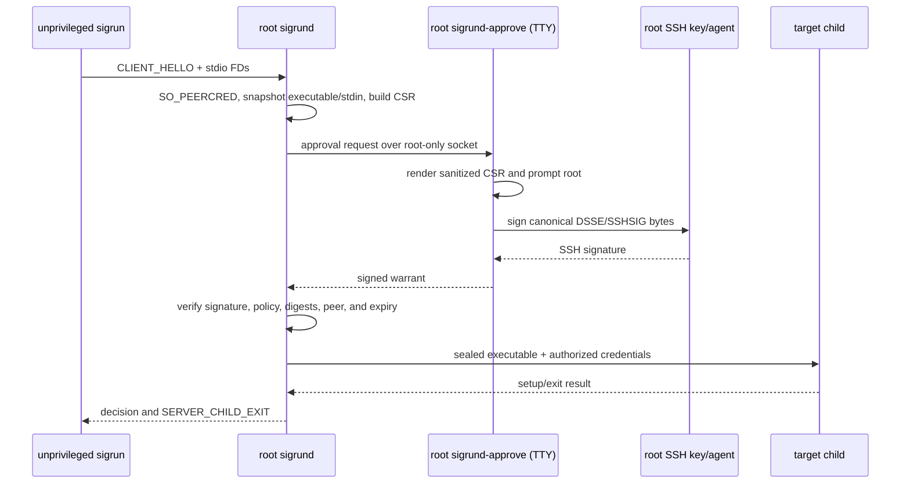

# sigrun/sigrund executable MVP roadmap

This roadmap turns the security specification into the first end-to-end
workflow that can be demonstrated on one Linux host:

1. An unprivileged user invokes `sigrun` with a command and standard I/O.
2. Root runs a foreground `sigrund-approve` process attached to a TTY.
3. `sigrund` presents the request to that root process.
4. Root confirms the displayed request and signs the exact canonical warrant
   with a root-controlled SSH key or SSH agent.
5. `sigrund` verifies the signed warrant, executes the sealed command for the
   authorized target identity, and returns the child's exit status to
   `sigrun`.

The first vertical slice uses `stdio`, local audit, one signed request at a
time, and `require_remote_audit_ack = false`. It excludes PTY transfer,
hooks, OpenPGP, Sigstore, remote collector ACKs, reload, and the full quota
stress matrix until the slice is working. Excluding those features is an MVP
scope decision; it does not change the v1.0 specification.

## Current status

The repository is at the foundation stage. The normal daemon and client
commands below are target interfaces for the roadmap; they are not available
until Phases 1–5 are complete.

- [x] Protocol, policy, snapshot, lifecycle, state, audit, memfd, and cgroup
  primitives with unit tests.
- [x] Raw `ssh-ed25519` and `sk-ssh-ed25519` SSHSIG verification helpers.
- [x] Phase 0: thin-MVP types and profile.
- [ ] Phase 1: daemon and approval-broker sockets.
- [ ] Phase 2: client transport and common snapshots.
- [ ] Phase 3: root TTY approval and SSH signing.
- [ ] Phase 4: authorization, commit, and local audit integration.
- [ ] Phase 5: child execution and exit relay.
- [ ] Phase 6: two-UID end-to-end fixture.

## The target interaction

The daemon never reads the root user's private key or TTY. The approval process
is a separate root-owned foreground client. It receives a request over a
root-only broker socket, renders the canonical request, asks for confirmation,
and returns a signature over the exact bytes it approved.



## MVP contract

The MVP is complete only when all of these statements hold:

- The daemon starts only after configuration, signer policy, host identity,
  audit state, and required local paths pass fail-closed validation.
- The client and daemon communicate using the Section 2 binary framing and
  the Section 2.3 descriptor ownership rules. The daemon obtains the caller's
  UID/GID from `SO_PEERCRED`; request JSON cannot claim identity.
- The daemon snapshots the executable before approval, hashes the sealed
  bytes, and sends the root approver the digest and every field that will be
  signed. The approved warrant must match the retained snapshot and CSR
  byte-for-byte at authorization time.
- The approval socket is a root-owned `SOCK_STREAM` endpoint with mode `0600`
  or an equivalent peer-credential gate. Only UID 0 may approve or sign.
- The prompt displays the executable path, argv, cwd, requester UID/GID,
  target UID/GID, capabilities, tty/stdin mode, digest, validity window, and
  signer identity. Values are sanitized according to Section 3.3.
- A refusal, timeout, disconnect, signature failure, policy mismatch, or
  snapshot mutation produces no child and no successful authorization.
- The private key remains in the root process or its SSH agent. `sigrund`
  receives only the SSHSIG signature and verifies it against the configured
  public key and `sigrun.warrant.v1` namespace.
- A successful child produces `READY_TO_EXEC`, then exactly one
  `SERVER_CHILD_EXIT`. `sigrun` returns the child's exit code or `128 + signal`.
- Every accepted authorization and child outcome is written to the local
  hash-chained audit log. A remote collector is not part of this first slice.

## Work plan

Each phase has a concrete exit gate. Do not begin the next phase while its
gate is failing.

| Phase | Main result | Estimate |
| --- | --- | ---: |
| 0 | Frozen MVP schemas and profile | 1 day |
| 1 | Daemon and root-only broker sockets | 1–2 days |
| 2 | Client transport and sealed snapshots | 2–3 days |
| 3 | Root TTY approval and SSH signing | 2–3 days |
| 4 | Authorization, one-time commit, and local audit | 2–3 days |
| 5 | `clone3`, credentials, reaping, and exit relay | 3–5 days |
| 6 | Two-UID integration fixture and hardening | 2–3 days |
| **Total** | **Thin end-to-end MVP** | **13–20 person-days** |

The estimate assumes the existing primitives remain usable and a Linux
engineer familiar with Rust, Unix sockets, namespaces, cgroups, and SSHSIG.
PTY, hooks, remote collectors, and the complete V-01–V-19 matrix are a
follow-on effort.

### Phase 0: freeze the thin-MVP boundary

Completed. The frozen configuration, command forms, broker documents, binding
rules, and verification commands are in [docs/MVP_PHASE0.md](docs/MVP_PHASE0.md).
This phase defines and tests the contracts; socket transport, approval prompts,
and execution are delivered by the subsequent phases.

Deliverables:

- Add a short MVP profile to the daemon configuration: `stdio` only, no hooks,
  no PTY, no remote ACK, and a single active approval request.
- Define the command forms and socket overrides used by tests, for example:
  `sigrund --foreground`, `sigrund-approve --socket PATH --tty /dev/tty`, and
  `sigrun --socket PATH -- COMMAND ARG...`.
- Add the missing warrant, CSR, DSSE envelope, and approval-message types to
  `sigrund-core` with strict JCS round-trip validation.

Exit gate:

```sh
cargo test --workspace
cargo clippy --workspace --all-targets -- -D warnings
```

The new types must reject unknown fields, duplicate keys, non-integer numbers,
oversized strings/arrays, and mismatched CSR/warrant fields before any spawn.

### Phase 1: daemon startup and local sockets

Deliverables:

- Move the normal `sigrund` path from validation-only mode into a foreground
  daemon loop with an injectable socket path for tests.
- Complete host identity and audit recovery before binding the client socket.
- Bind `/run/sigrund.sock` with the ownership and mode from the specification,
  enable `SO_PEERCRED`, and enforce active socket limits at `accept4()`.
- Add a separate root-only approval broker socket. Reject untrusted broker
  peers before parsing request data.
- Add bounded read/write helpers around `FrameAssembler`, cumulative frame
  deadlines, and descriptor cleanup.

Exit gate:

- A test daemon accepts a client hello, records the peer UID/GID, and rejects
  malformed or oversized frames without leaking descriptors.
- A non-root process cannot connect to the approval broker or submit a signed
  decision through it.

### Phase 2: client hello and common snapshots

Deliverables:

- Implement `sigrun` command parsing, current-working-directory capture,
  exact environment construction, and `stdio` `SCM_RIGHTS` delivery.
- Implement the common executable snapshot worker using anchored roots,
  bounded reads, cancellation checks, memfd seals, ownership, and digest
  binding.
- Implement hashed-stdin snapshots for `stdin_policy = "sha256"`; use
  `/dev/null` for `null`.
- Keep all source FDs, workers, and snapshot quota reservations owned until
  their actual cleanup completes.

Exit gate:

- The daemon can inspect a real request from a non-root test account and
  produce a canonical CSR without invoking a hook or reopening the source
  executable.
- Mutation, traversal, FIFO/socket/directory descriptors, timeout, and
  cancellation tests fail closed.

### Phase 3: root approval and SSH signing

Deliverables:

- Implement `sigrund-approve` as a foreground root process. It receives a
  bounded approval request, displays the sanitized fields, and handles `yes`,
  `no`, EOF, timeout, and disconnect.
- Make the approval request contain the exact canonical CSR bytes or a digest
  plus all display fields. The signer must sign those exact bytes; the daemon
  must reject any returned warrant that changes a CSR field.
- Add SSH signing through the root SSH agent first. As a fallback, invoke
  `ssh-keygen -Y sign` in the root process and convert the armored SSHSIG to
  the raw binary envelope required by Section 3.4.
- Bind the configured signer ID, public key, namespace, signature algorithm,
  and optional FIDO UP/UV flags. Keep private-key bytes out of daemon memory.

Exit gate:

- A real root TTY can approve and sign one request with an `ssh-ed25519` key.
- A changed argv, digest, target UID, or CSR byte causes authorization
  failure, even when the signature itself is valid.
- Root refusal and approval timeout never consume a one-time grant or spawn.

### Phase 4: authorization, commit, and local audit

Deliverables:

- Implement the complete local Section 4.2 authorization predicate for the
  thin profile: host, peer credentials, signer ceilings, path identity,
  command/stdin digests, environment, tty/stdin compatibility, validity, and
  same-UID guard.
- Integrate `StateStore::authorize` with the lifecycle CAS reservations.
- Append `AUTH_COMMIT`, `AUTH_ABORTED_POST_COMMIT`, rejection, and diagnostic
  records through the serialized audit writer.
- Return the specified decision status and sanitized message to the client.

Exit gate:

- Valid requests pass exactly once; concurrent redemptions return
  `REPLAY_DETECTED`.
- Expired, revoked, wrong-peer, wrong-host, wrong-signer, digest-mismatch,
  and changed-file requests return the specified denial without a child.
- Audit reopen and crash-recovery tests pass after approval and denial paths.

### Phase 5: child execution and exit relay

Deliverables:

- Create the per-job cgroup and apply memory, swap, OOM, and PID limits.
- Implement `clone3()` with `CLONE_INTO_CGROUP`, `CLONE_PIDFD`, and the
  namespace/credential transition required for the selected MVP target.
- Build the deterministic descriptor table for stdin/stdout/stderr and the
  sync-pipe readiness/error handshake.
- Add the central reaper, disconnect cancellation, cgroup teardown, and
  `SERVER_CHILD_EXIT` serialization.
- Keep the commit and spawn reservation phases intact when cancellation wins.

Exit gate:

- `sigrun --socket ... -- /usr/bin/id` returns the approved child's exact
  status and leaves no job cgroup, pidfd, or request FD behind.
- Kill-before-ready, exec error, timeout, client disconnect, and child signal
  cases produce the specified result and audit records.

### Phase 6: end-to-end MVP fixture

Add an isolated Linux fixture with:

- a root account running `sigrund` and `sigrund-approve` on a controlled TTY;
- a separate unprivileged requester account;
- a dedicated root SSH signing key or test SSH agent;
- a pinned executable under an allowed root;
- temporary socket, state, log, and cgroup paths; and
- deterministic gates around approval, commit, clone, readiness, and exit.

The primary acceptance command should exercise the complete workflow:

```sh
# root terminal 1
sudo sigrund --foreground --socket "$TEST_SOCKET"

# root terminal 2
sudo sigrund-approve --socket "$TEST_APPROVAL_SOCKET" --tty /dev/tty

# requester terminal
sudo -u mvp-requester sigrun --socket "$TEST_SOCKET" -- /usr/bin/id
```

The fixture passes only when the root prompt shows the request, the root
signature is accepted, the command runs under the authorized credentials, the
requester receives its output and exit status, and denial/mutation/replay
subcases all fail closed.

## Required tests by milestone

The thin workflow should add these focused integration cases before expanding
scope:

| ID | Case | Required result |
| --- | --- | --- |
| M-01 | Root approval and valid SSH signature | One child runs and its status reaches `sigrun`. |
| M-02 | Root refusal and approval timeout | No spawn, no grant consumption, bounded denial. |
| M-03 | Non-root approval-socket connection | Rejected before request parsing. |
| M-04 | CSR mutation after approval | Signature or field binding fails; no spawn. |
| M-05 | Executable mutation during snapshot | Snapshot denial; no approval or spawn. |
| M-06 | Same one-time warrant from two requesters | Exactly one commit; all others replay-denied. |
| M-07 | Client disconnect during approval/commit/spawn | Reservation reconciliation and cleanup complete. |
| M-08 | Child exits normally, by signal, and before readiness | Exact decision and exit contract. |
| M-09 | Descriptor truncation/extra FD and oversized frame | Connection closes; no leaked FD or child. |
| M-10 | Audit restart after partial and forward-recovery windows | Startup succeeds only for valid recoverable states. |

After M-01 through M-10 pass, implement the remaining V-01 through V-19
matrix rows. PTY, hooks, remote collector ACK, reload, OpenPGP, and Sigstore
should enter separate milestones so failures remain attributable.

## Definition of done

The thin MVP is ready for review when:

1. M-01 through M-10 pass on a disposable Linux host with two distinct UIDs.
2. `cargo test --workspace`, Clippy, formatting, and the integration fixture
   pass from a clean checkout.
3. The normal binaries no longer exit with the service-unavailable status for
   the documented MVP commands.
4. No private key, approval decision, or child result is accepted through an
   unauthenticated path.
5. The implementation notes are updated to mark each completed phase, while
   the v1.0 specification remains the authority for deferred features.

