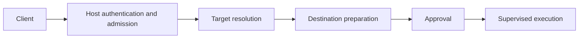

# Namespace-aware execution

Design discussion recorded on 2026-10-31; refined on 2026-11-05. This document
proposes one host daemon serving explicitly selected execution environments.
It describes follow-on work: the selectors, instance bindings and security
profiles below are not implemented CLI options or protocol fields. The
[security specification](<../sigrun sigrund Security Architecture and Implementation Specification.md>)
continues to define the current local profile.

## Current implementation

Jobs execute in the daemon's configured domain. Child setup creates private
mount/cgroup namespaces for isolation; it does not enter a selected container
or follow requester namespaces. The requester-access helper resolves files in
the daemon's filesystem domain under authenticated UID/GID/groups and requires
initial user-namespace mappings. It does not reproduce requester LSM confinement.
Direct executable models use an exec-stop checkpoint to verify evidence and
credentials; that is not currently a general LSM transition verifier.

See the [implementation notes](../IMPLEMENTATION_NOTES.md#deferred-namespace-aware-executable-evidence)
for scope, evidence limitations and existing test coverage. Namespace-root test
fixtures do not establish support for the workflows proposed here.

## Goals and deployment

Support execution inside existing local OCI containers, including rootful and
rootless containers owned by the requester or another user. All requests go to
one host sigrund authority for authentication, policy, root-TTY approval and
supervision. Containers need a client and socket access, without an internal
daemon or container creation by sigrund.

| Story | Request origin | Destination | Target account and numeric IDs |
| --- | --- | --- | --- |
| 0 | Host | Existing container B | Interpreted in B |
| 1 | Container A | Host | Interpreted on the host |
| 2 | Container A | Its own supported execution environment | Interpreted in that environment |
| 3 | Container A | Existing container B | Interpreted in B |

For container-to-host execution, the selected user is a host user. Translating
a container account through its UID/GID mappings into a host execution identity
is a separate, deferred selection mode. Root in a rootless container is relative
to its user namespace and must not be presented as host UID 0.

Operators explicitly expose the host client socket in containers. Sigrund does
not inject sockets or modify containers to provide access. The current client
also queries public preparation context on a separate endpoint whose pathname
is the client socket path plus `.context`; deployments must expose every
endpoint needed by the client, preserving that path relationship. This proposal
does not consolidate endpoints. The approval socket and host state remain under
host administration. Socket DAC and SELinux/AppArmor rules must permit access;
reachability permits submitting a request, not bypassing authorization.

This design covers local execution, not remote hosts or delegated proxy
authentication. A privileged container that already controls the host, daemon
state or management interfaces is outside the daemon's isolation guarantee.

## Architecture and integration choices



The proposed common backend is a native Linux namespace executor. Target
resolvers supply validated execution resources to that backend. The host
coordinator retains its original environment; dedicated helpers prepare and
execute in the destination.

| Approach | Useful capabilities | Integration boundary |
| --- | --- | --- |
| Manager exec APIs | Manager inventory, lifecycle and execution sessions | Separate Docker/Podman/containerd integration; interfaces may not expose retained executable FDs, job placement or exec-stop verification |
| Direct runc/crun integration | OCI bundle/state operations and low-level execution | Requires runtime binary, state root, IDs and invocation conventions; bypassing a manager can break its bookkeeping and cleanup assumptions |
| Native namespace executor | Sigrund-controlled file preparation, child setup and supervision | Must implement and verify mappings, namespace entry, security constraints and lifecycle handling |

OCI provides a configuration vocabulary for namespaces, mappings, capabilities,
seccomp and LSM labels. It supplies neither globally unique container identity
nor a universal discovery/control API. Direct runc/crun access beneath an
existing manager is not a supported universal control plane.

Manager resolvers are optional additions for names, ownership metadata,
configuration and lifecycle events. A manager-confirmed identity is additional
evidence, distinct from a process environment. Runtime scopes must distinguish
endpoints, owners/tenants and manager namespaces. User-owned runtime metadata
cannot independently authorize host privileges or arbitrary namespace entry;
the daemon validates resources and applies host policy.

The native executor provides a defined sigrund execution profile. Exact
reproduction of a manager's exec policy requires additional configuration
integration and validation. Namespace entry alone does not reproduce that policy.

## Target selection and identity

Three conceptual selectors are proposed:

| Selector | Resolution |
| --- | --- |
| Host | The host daemon's configured execution environment |
| Self | The authenticated caller's supported execution environment |
| Explicit target | An administrator-registered environment or a validated process reference; optional manager resolvers translate names |

The following CLI sketches are **unimplemented proposals**, not usable commands
or a finalized option grammar. Named container targets require a resolver or
explicit registration.

```sh
# Host -> existing container, selected through a configured resolver.
sigrun --container alice/devbox --user builder -- /usr/bin/id

# Container -> host, selecting a host account.
sigrun --host --user alice -- /usr/bin/id

# Container -> its authenticated caller environment.
sigrun --container self --user root -- /usr/bin/id

# Container -> another existing container.
sigrun --container bob/database --user postgres -- /usr/bin/id
```

Distinguish a caller-provided selector, a daemon-validated pinned execution
environment, and an optional manager-confirmed container identity. A name is
presentation and selection input, not authority. A process reference is an
input to validation, never authorization by itself; its PID is interpreted in
an explicitly defined PID namespace rather than guessed from caller input.

Reuse `host_id` for the authorizing daemon. Propose an opaque, ephemeral
target-instance binding in signed approval, backed by a retained process
reference, namespace FDs, root directory FD, verified mappings and lifecycle
observations. A random token alone provides no binding. Numeric PID lookup
must be protected against reuse while resources are acquired and cross-checked.

Resolve and pin before approval, then revalidate before authorization and spawn.
Reject if the anchor exits, its relevant context changes, or observations
cannot be reconciled. Never reopen a matching name/PID and silently substitute
a new target. Retained namespace FDs can outlive the container and do not prove
that its instance remains alive. Daemon restart invalidates ephemeral
registrations and warrants referring to them. Manager integration may strengthen
restart/teardown detection; without it, the binding identifies the validated
process environment rather than a universal container generation.

| Candidate identity | Why it is insufficient alone |
| --- | --- |
| Container name or hostname | Mutable and reusable |
| PID | Reused and relative to a PID namespace |
| Namespace inode or set of inodes | Can be shared; unpinned identities can be reused; callers can change their namespace set |
| Cgroup path | Can be recreated or reorganized and does not describe the entire execution environment |
| Image digest | Identifies image content shared by many running instances |
| Native runtime ID | Requires runtime scope and can survive or be reused across execution instances |

### Authenticating the source and self

Use kernel-authenticated Unix peer credentials and groups as the starting
identity, as observed by the host daemon. Container-supplied usernames, UIDs,
container IDs and labels are claims. UID/GID mappings and unmapped/overflow
credentials need explicit validation; container UID 0 is not automatic host
authority.

`self` means the authenticated caller's supported environment. A caller may
have unshared namespaces, so this need not equal its manager's original
container environment. Shared namespaces do not uniquely identify a container.
If source attribution or the required context is ambiguous, reject `self`;
an explicit destination still requires ordinary authentication and policy.

Before implementation, define whether a request is attributed to the connector
or an authenticated message sender. `SO_PEERCRED` captures connection-time
credentials; a socket can subsequently be inherited or passed. Reading procfs
for that PID later does not establish the request sender's current context.
Process exit/reuse, credential changes, exec and namespace changes must be
handled in one race-checked acquisition contract. Per-message authentication
must not be assumed from the current transport. Socket visibility alone cannot
prove container origin.

## Destination preparation and authorization

Prepare executable evidence, cwd and execution environment in the verified
destination. Resolve target usernames, numeric UID/GID and supplementary groups
there, with bounded account lookup and no implicit host NSS lookup for a
container account. Validate mappings and authority ceilings and reject unmapped
identities. Account names are display/selection inputs; sign resolved numeric
credentials and the mapping context so later account changes cannot redirect
the approved identity.

Interpret executable paths, cwd, scripts and other path arguments in the
destination. Do not automatically copy caller files or inherit a container cwd
as a host cwd. Construct and bind the approved environment explicitly. Retain
the selected executable and immutable stdin before review; mutable scripts,
loaders, libraries and configuration remain outside executable evidence as
explained in [privileged interpreter guidance](PRIVILEGED_INTERPRETERS.md).

Cross-domain workflows should provide an explicit thin-intent path for private
destination preparation. Full CSR support requires trustworthy destination
evidence and a defined requester-access check in that destination. Existing
UID/GID impersonation does not establish caller LSM/Landlock restrictions or
arbitrary namespace access. Unsupported full-request access domains must fail
closed, rather than using daemon privilege as proof of requester access.

Preserve full/thin provenance, intent binding, `--full-only` and CSR-export
semantics. Neither full-only nor export may silently invoke privileged thin
expansion. Reconcile unsigned full-CSR trust-model selection against the
destination before approval. Once signed, executable bytes, trust model and
target cannot be switched or downgraded on mismatch.

The current [ComposeFS evidence limitation](../IMPLEMENTATION_NOTES.md#deferred-namespace-aware-executable-evidence)
illustrates the issue: a cloned mount tree can make client selection choose
memfd while daemon-local selection chooses direct execution. Fixing destination
resolution and evidence negotiation is required; matching pathnames or forcing
snapshot selection does not by itself establish cross-domain correctness.

Approval must bind and display the authority, target instance, verified target
description, numeric credentials and mapping context, executable evidence,
stdin/cwd/environment and execution-security constraints. A friendly name alone
is insufficient. Named security profiles must resolve to bound constraints or
an immutable version; changed policy must not silently change an old grant's
authority. New signed target/profile semantics need explicit protocol and
signature versioning, not reinterpretation of existing warrants.

Cross-owner execution requires requester policy and signer approval. Container
ownership neither automatically grants nor forbids it. Possession of a signing
key and access to the socket do not override host policy. Approval must clearly
distinguish host root, rootful container root and mapped rootless container root.

## Execution and lifecycle ownership

Namespace entry runs in dedicated helpers with bounded IPC and no daemon secrets
or management FDs leaked to the target. Entry ordering must account for the
owning user namespace, capabilities needed for subsequent operations, mount/root
setup and PID/time namespace rules. Joining a PID namespace affects subsequently
created children, requiring a defined child-creation and reaping sequence.
Retain destination references and verify the final context before execution.
The coordinator must never change its own namespaces.

The future child path must preserve retained executable evidence while setting
root/cwd, groups, UID/GID, capabilities, NNP and security profiles in a validated
order. Preserve the syscall-only post-clone setup invariant: prepare storage
and any library-derived transition data before that critical child path.
Rootless mappings, restrictions on `setgroups`, idmapped mounts and
namespaced file capabilities require explicit supported-platform decisions and
tests. Host root alone does not prove every combination is implementable.

Namespace membership and cgroup membership are separate. Joining a cgroup
namespace changes the view, not process placement. Define per-job placement that
preserves host-enforced memory/PID limits, whole-job termination and compatible
container lifecycle behavior. Do not blindly move jobs into manager-owned
cgroups or assume the existing `CLONE_INTO_CGROUP` sequence transfers unchanged
across user namespaces. Placement/delegation is an implementation prerequisite.

The host daemon owns admission, replay checks, durable grant consumption, audit,
output, cancellation, deadlines, reaping and cleanup. Container stop/delete,
anchor death and resolver loss must not redirect execution or leave descendants
outside supervision. Manager adapters supply lifecycle evidence, without
transferring authorization ownership. Target resources and helper reservations
remain bounded and are released after actual completion/cleanup.

Preserve the existing disclosure boundary: unsuccessful admitted thin requests
receive the uniform `TIMEOUT` at the fixed deadline. Target existence, account
lookup, LSM denial and preparation details stay private before approval. Avoid
adding public diagnostic/lookup endpoints that bypass this rule. `APPROVED`
means durable authorization, not successful spawn; readiness and execution
results remain separate, and the complete approval response must precede spawn.
Explicit rejection remains available only to validated full requests under
the existing rules. A failure after durable consumption does not refund
a one-time grant. Pre-authorization failures do not consume it.

## Security-profile contract

The executor must specify what it reproduces, explicitly configures and verifies.
It cannot promise equivalence to a manager's exec operation from namespace
membership alone.

| Property | Proposed treatment | Required verification or integration |
| --- | --- | --- |
| Namespaces and filesystem root | Enter the validated destination environment; apply declared child isolation | Namespace ownership, pinned root, mount behavior and final process context |
| Accounts, groups, cwd and environment | Resolve/configure explicitly in the destination | Mappings, exact credentials and signed execution inputs |
| Capabilities, securebits and NNP | Configure under the signed authority ceiling | Before/after-exec sets and compatibility with transitions/file capabilities |
| Cgroup resources | Explicit host-supervised job placement | Delegation, manager teardown interaction and complete descendant cleanup |
| SELinux/AppArmor | Explicit supported transitions and expected resulting confinement | Source attributes, effective labels/profiles, enforcement state and policy changes |
| Seccomp and other task restrictions | Apply a declared supported profile where available | Existing target filters cannot generally be extracted and copied through a simple supported API; manager configuration may be needed |

Collect source LSM attributes through applicable kernel interfaces, such as
`SO_PEERSEC`, with their documented meaning and observation time. Peer socket
security attributes are not a complete live process identity. Keep observed
source identity, approved target constraints and observed execution results
distinct in private audit. Dropping UID/GID does not reproduce requester LSM
confinement; entering namespaces does not inherit another task's LSM or seccomp
state.

SELinux constraints need the complete context, including MLS/MCS range.
AppArmor constraints need the applicable policy namespace, profile/stack and
enforcement mode. Support composable constraints rather than assuming one
mutually exclusive LSM. Disabled, unreadable, unconfined, permissive/complain
and enforcing states are distinct; none may substitute for required enforcing
confinement. Policy reload or profile-name reuse must trigger the defined
version/revalidation contract, without claiming that a label fixes policy bytes.

The current child enables `no_new_privs`, and direct execution uses ptrace.
Both can affect LSM transitions. Do not silently remove NNP or tracing to make
a transition succeed. Verify supported combinations on actual enforcing
platforms. Setting a requested transition successfully does not prove the
post-exec state. Extend verification to check actual confinement before releasing
target/loader instructions, including applicable memfd execution paths. Where
that cannot be guaranteed, reject the combination. An exec-stop check does not
undo kernel state changes that already occurred during exec.

Memfd execution does not preserve the source file's label/path semantics and
may behave differently for SELinux entrypoints or AppArmor rules. Profiles
requiring source-file semantics must use a validated executable model; never
silently switch the signed model. Pinned namespaces/root/executable references
do not freeze mutable root filesystems, libraries or security policy.

Unsupported or unverifiable combinations fail closed. Daemon packaging also
needs its own LSM policy for socket access, helpers, state, cgroups and
verification operations; that policy is separate from target confinement.

## Delivery stages and verification gates

These stages describe future implementation work, not features established by
this document:

1. Define source authentication, target acquisition/registration, instance
   invalidation and versioned approval contracts. Establish socket-passing and
   process-race semantics before enabling `self`.
2. Implement native execution and destination-local preparation, including
   rootless credentials, cgroup placement and full/thin evidence behavior.
   Exercise all four routes using explicitly validated targets.
3. Implement supported LSM transitions, actual-state verification and daemon
   packaging policy. Validate NNP, tracing, executable models and seccomp
   constraints on enforcing platforms.
4. Add optional manager resolvers for friendly names, ownership/configuration
   metadata and stronger lifecycle tracking, reusing the executor and approval
   contracts. Expand supported platforms only after their gates pass.

Required acceptance scenarios include:

| Area | Scenarios and required outcome |
| --- | --- |
| User stories | All four routes, rootful/rootless targets and same-owner/cross-owner requests; correct destination and numeric user, with explicit policy/approval |
| Mapping and authority | Nested/unmapped UID/GID, supplementary groups, rootless UID 0 and host users; reject unsupported mappings and never reinterpret container root as host authority |
| Instance binding | PID reuse, anchor exit, restart/replacement, context changes and daemon restart during approval; reject stale bindings without retargeting |
| Source attribution | Shared/unshared namespaces, inherited/passed sockets, connector exit and exec/credential races; authenticate according to the defined source contract or reject |
| Destination evidence | Same paths with different bytes/cwd, account changes and mutable roots; use retained destination evidence and resolved signed credentials |
| CSR and ComposeFS | Cloned ComposeFS mounts/`PrivateMounts=`, default/full-only/export/thin paths and signed mismatches; preserve intent/provenance and reject signed substitutions without model switching |
| Confinement | Real SELinux/AppArmor enforcement, permissive/complain/disabled states, policy changes, seccomp limits and NNP/ptrace/direct/memfd combinations; require the declared effective constraints |
| Lifecycle and privacy | Cancellation/disconnect, container deletion, helper/tracer death and resource exhaustion; bounded whole-job cleanup, private pre-approval failures, durable audit and correct one-time consumption |

Namespace entry ordering, race-resistant source capture, userns/cgroup
compatibility and enforceable LSM verification remain implementation
prerequisites. Existing namespace-root fixtures and delegated-platform tests
supplement, but cannot replace, these acceptance gates.
